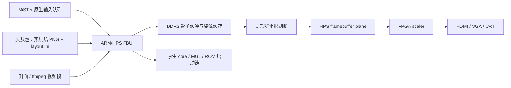

# MISTER_FBUI

> **实验性项目 / Experimental**
> 本项目仍处于快速研发阶段，可能出现花屏、布局越界、视频预览卡顿、皮肤缺失或模式切换失败。请务必备份 SD 卡根目录中的原版 `MiSTer`，不要将当前版本视为稳定发行版。

MISTER_FBUI 是基于 MiSTer 主程序的实验性全屏图形前端。目标是在不修改 FPGA HDL、也不移植完整 EmulationStation 的前提下，利用 DE10-Nano 的 ARM/HPS、板载 DDR3 和 MiSTer 已有的 framebuffer/scaler 通路，实现：

- 全屏图形菜单、系统背景、Logo、封面与视频缩略图；
- 可动态显示游戏名和目录名的中文字体；
- 离线烘焙的 PNG 皮肤包，运行时零解析开销；
- 240P CRT 与高清 HDMI 菜单模式（开机二选一）；
- 保留 MiSTer 原生输入、核心启动、MGL 和 ROM 挂载流程。

> 如果你是来做代码审核的，请先读 [`docs/CODE_REVIEW_GUIDE.md`](docs/CODE_REVIEW_GUIDE.md)（英文），它划定了审核范围并说明了必须遵守的约束。

## 核心思路

传统 MiSTer 菜单主要由 FPGA OSD 绘制，稳定且延迟低，但颜色、字体、图片和布局能力有限。本项目把复杂界面交给 ARM/HPS：先在普通缓存内存中完成软件绘制，再把变化区域写入 MiSTer 的 HPS framebuffer 平面，由 FPGA scaler 合成到 HDMI/VGA。



这种架构处在“字符 OSD”和“完整 Linux 游戏前端”之间：比 OSD 自由，同时比移植大型桌面前端更轻，更容易保持 MiSTer 原生行为。

## 当前技术架构

### 执行模型

FBUI 是**协作式单线程**的，跑在菜单主循环上：`menu.cpp` 在 `menu_key_get()` 之后调用 `fbui_ui_hook()`，FBUI 激活期间接管全部按键。

没有工作线程。任何阻塞操作——解码 JPEG、扫描目录、等待子进程——都会让输入卡住同样长的时间。因此图片预取写成"每个空闲 tick 走一步"的增量状态机，而不是循环。**在这条路径上引入阻塞调用属于功能退化，即使代码更好看。**

### 绘图与刷新

- `fbui.cpp`：浏览器状态、布局、输入、游戏扫描、软件光栅化、两套缓存、视频预览、开机分辨率选择器。
- `fbui_skin.cpp`：皮肤包加载、`layout.ini` 绝对坐标解析、图片解码与合成。
- `fbui_text.cpp`：高清档的 TrueType 排版与字形缓存。
- `video.cpp`：framebuffer plane 访问，以及菜单期的分辨率应用/恢复接口。
- 影子缓冲和静态背景层位于可缓存 DDR3 内存；只有脏矩形会复制到较慢的 framebuffer 映射。

### 中文字体

两套引擎按开机选定的分辨率二选一，互不干扰：

- **高清档**用 `stb_truetype` 排版皮肤指定的 TTF，缓存 `(字体, 字号, 码点) → 8bpp alpha` 位图；TTF 缺失的码点（主要是 CJK）回退到 GNU Unifont 点阵。
- **240P 档**完全走点阵引擎。CJK 按 **32 宽 × 16 高**绘制以抵消 640×240 的 1:2 像素宽高比，在 CRT 上看起来才是方的；英文数字使用 8×8 点阵整数放大。请求字号会按 16 的倍数就近量化。

240P 不用抗锯齿字面是有意的：16px 的灰度边缘在 240 线 CRT 上反而比纯点阵更糊。

### 皮肤系统

皮肤在 PC 上**离线烘焙**，设备端只做解码和贴图：

```
skins/<name>/
├── skin.ini          # 皮肤元信息
├── 240p/
│   ├── bg.png        # 预合成的静态背景层（背景 + 页眉 + 页脚 + 面板）
│   └── layout.ini    # 绝对坐标、字号、配色
└── 1080p/
    ├── bg.png
    └── layout.ini
```

`layout.ini` 全部是帧缓冲像素的绝对坐标，运行时不做任何缩放计算。两档分辨率的资源不会同时加载——开机选了哪档就只读哪个子目录。

这套方案取代了早期在 ARM 上实时解析 EmulationStation `theme.xml`、用 NanoSVG 光栅化 SVG、再由 Imlib2 缩放大图的做法。`bake.py` 里的几何计算刻意与 `fbui_skin.cpp` 的 `skin_defaults()` 保持一致，**这处重复是已知隐患**：两边漂移会导致布局静默错位。

### 视频缩略图

- `ffmpeg` 在后台循环解码低尺寸、低帧率预览到 `/tmp/fbui_prev.png`；
- 主程序读取最新预览帧，不让视频解码器直接阻塞输入循环；
- 当前实现仍以稳定性验证为主，未来会增加首帧缓存、帧环形缓冲和解码进程复用。

### 游戏截图下载

- `tools/GamelistEditor` 可从 Libretro Thumbnails 下载 `Named_Snaps` 游戏截图；
- 图片冲突时可选择覆盖已有图片，或跳过已有图片只补缺失项；
- 普通主机截图按 ROM 基础文件名保存到 `games/<system>/images/`，与现有 gamelist 路径兼容；
- 工具的主机列表与 FBUI 一致，只显示含受支持 ROM 的系统；所有 MRA 街机统一显示为 `Arcade`，媒体位于 `/_Arcade/images/`。
- 游戏页截图在主显示区内等比例完整放大，不裁切；240P 会校正 640×240 非方形像素的显示比例，比例不同时以黑边补足。

### DDR3 缓存策略

DE10-Nano 物理上有 1GB HPS DDR3，但当前 MiSTer Linux 启动布局在实机上只向 ARM 暴露约 492MB，而且 scaler 的 framebuffer 也住在同一片内存里。项目读取 `/proc/meminfo` 的 `MemAvailable` 动态确定缓存规模，而不是按纸面容量固定吃满内存：

- 至少为 Linux、MiSTer、framebuffer 和 ffmpeg 保留约 256MB，上限再受皮肤的 `cache_mb` 约束；
- 缩略图与系统展示图**共用一个内存池**，按 60% / 40% 切分——否则先初始化的那个会把内存吃光，饿死另一个；
- 缩略图采用按字节预算的窗口缓存：当前页加上前后各一页，槽位数由预算除以固定槽位尺寸反推；
- 每个空闲循环最多解码一个资源，输入处理优先；
- 缓存满时按 LRU 淘汰。

## 240P 与高清模式

两档模式**不能同时显示**，因此在进入菜单前用硬件 OSD 让用户选择：

- **240P**：面向 15kHz CRT，640×240 时序，使用过扫描安全边距、紧凑标题/页脚和放大的中文；
- **高清**：沿用启动前的高清时序，使用更宽松的布局。

选择只影响菜单本身；启动游戏后会恢复 `MiSTer.ini` 里的设置（HDMI 高清 + VGA 核心原生）。

CRT 的实际过扫描量、HDMI/VGA 同步、framebuffer 尺寸和视频模式切换并非原子操作，因此这部分仍是目前风险最高的区域。测试时应始终保留可回滚的 `MiSTer` 二进制。

## 当前困难与障碍

我们已经证明 ARM framebuffer 可以承载图形菜单、中文、皮肤和视频缩略图，但距离稳定发行还有明显差距：

1. **240P CRT 适配**：不同电视的过扫描不同，大字体、可见行数和版面构图需要继续平衡。
2. **模式切换稳定性**：视频时序、scaler 与 framebuffer 重映射不同步时可能出现花屏。
3. **布局几何重复**：`bake.py` 与 `skin_defaults()` 各算一遍，缺少一致性校验。
4. **ARM 性能**：Cortex-A9 可以完成界面绘制，但大图缩放和视频解码仍需缓存、预取与限帧。
5. **内存边界**：板载 1GB 并不等于 Linux 可自由使用 1GB，必须根据真机可用内存动态预算。
6. **视频依赖**：视频预览依赖设备端 `ffmpeg`，不同安装环境需要降级路径；当前的子进程调用方式也需要加固。
7. **输入体验**：重解码期间必须抑制按键重复和队列突发，避免"卡住后连跳多项"。
8. **异常恢复**：实验版需要更完善的启动看门狗、自动回滚和安全模式。
9. **缺少测试**：目前没有任何自动化测试，也缺少可供单元测试的接缝。

这些问题正在逐项攻克。当前仓库的价值是验证架构、记录工程路径并提供可重复实验基础，而不是宣称已经替代官方菜单。

## 编译

推荐环境：

- WSL2 Ubuntu（Makefile 不支持原生 Windows）；
- Arm GNU Toolchain `10.2-2020.11`，目标为 `arm-none-linux-gnueabihf`；
- GNU Make；
- 仓库自带的 Imlib2 及其依赖（FreeType / libpng / zlib / bzip2），以及 vendored 的 `lib/stb/stb_truetype.h`。

```bash
# 一次性：下载工具链。上游脚本默认解压到仓库根目录，而 build.sh 去 $HOME 找，
# 这里显式指定安装位置让两者对上。
MISTER_GCC_INSTALL_DIR="$HOME" source ./setup_default_toolchain.sh

# 编译，产物为 bin/MiSTer
./build.sh -j"$(nproc)"
```

工具链装在别处时用 `ARM_TOOLCHAIN_DIR` 指定。编译应当在 `-Wall -Wextra` 下零警告。

## 皮肤工具链

```bash
# 烘焙皮肤包：把源素材转成两档分辨率的 bg.png + layout.ini。
# --out 必填；不给 --bg 就用内建渐变合成静态层。完整参数见 --help。
python3 tools/skinbake/bake.py --out skins/default --name Default

# 生成网页预览（自包含单文件，内嵌布局、背景和 Unifont 子集）
python3 tools/skinpreview/gen.py
# 然后用浏览器打开 tools/skinpreview/preview.html

# 部署到真机。机器是 DHCP，IP 漂了先用 findmister.sh 扫出来
bash tools/skinbake/findmister.sh
MISTER=<ip> bash tools/skinbake/deploy.sh bin    # 传到 /media/fat/MiSTer.new
MISTER=<ip> bash tools/skinbake/deploy.sh skin   # 传皮肤包
MISTER=<ip> bash tools/skinbake/deploy.sh swap   # 原子替换，保留 .bak
```

网页预览在没有真机的情况下用来核对两档布局、中文可读性和缩略图比例。它用 JavaScript 重新实现了点阵文字引擎，**不是**生产代码路径，两者若有出入以 C++ 为准。

## 基本配置

在 `MiSTer.ini` 中启用：

```ini
FBUI=1              ; 启用图形前端
FBUI_SKIN=default   ; 皮肤包名，对应 skins/<name>/
```

`FBUI_THEME` 是旧版选项，现已忽略，保留它只是为了让老的 INI 不至于解析报错。

皮肤包、GNU Unifont、封面和视频文件需要部署到 SD 卡对应目录。

## 安全测试建议

1. 备份 `/media/fat/MiSTer`；
2. 先上传为 `MiSTer.new`；
3. 校验文件大小和 MD5；
4. 保留稳定版文件名后再原子替换；
5. 先验证高清，再验证 240P CRT；
6. 出现花屏或无法操作时立即恢复稳定版。

## 上游与许可证

本项目基于 [MiSTer-devel/Main_MiSTer](https://github.com/MiSTer-devel/Main_MiSTer) 的主程序代码进行实验性开发，继续遵循仓库中的 GPL-3.0 许可证。MiSTer、第三方皮肤、字体和媒体资源分别受其各自许可证约束；本仓库不打包 ROM、BIOS、私人对话备份或大规模第三方元数据库。
